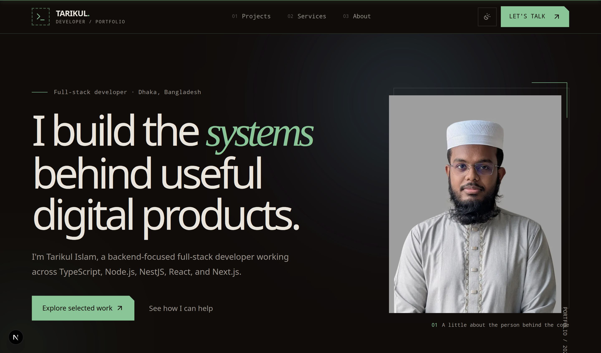
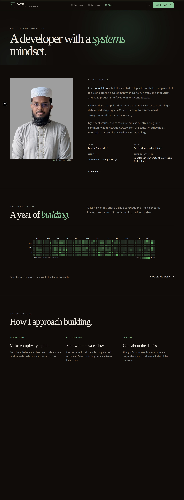
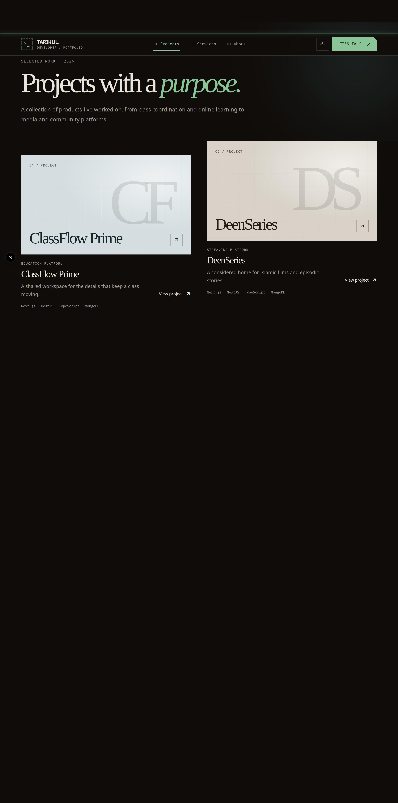
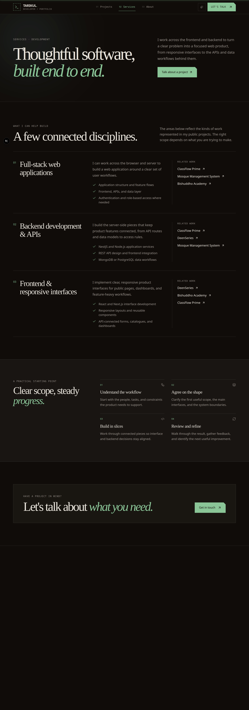
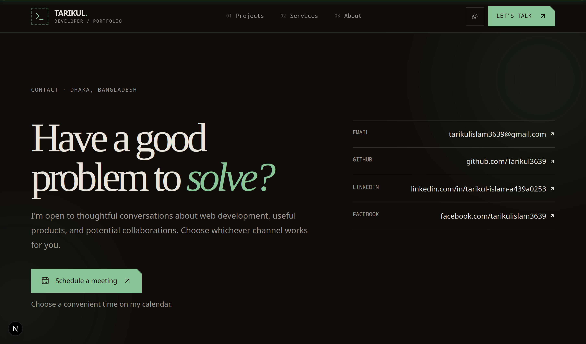

# Portfolio v5

Personal portfolio for **Tarikul Islam**, a Bangladesh-based **Software Engineer & Full-Stack Developer** focused on useful, well-structured web products.

[](https://nextjs.org/)
[](https://react.dev/)
[](https://www.typescriptlang.org/)
[](https://tailwindcss.com/)

**[Live website](https://tarikul-islam.me)** · **[Source repository](https://github.com/Tarikul3639/portfolio-v5)**

The public domain is configured as the canonical site URL in the Next.js metadata, sitemap, robots configuration, and structured data.

## About the project

Portfolio v5 is a server-rendered Next.js App Router site with an editorial visual system: large serif headlines, monospace labels, thin borders, muted green accents, and generous whitespace. Content is maintained as typed local data so project pages, metadata, and links stay consistent without an API or client-side content fetching.

## Features

- Responsive portfolio homepage with hero, experience highlight, featured work, technology marquee, working approach, and contact CTA.
- About page with biography, compact technology overview, public GitHub contribution calendar, and development principles.
- Projects index and statically generated project detail pages for education, streaming, community, and EdTech products.
- Technology stack page covering frontend, backend, databases, programming languages, and tools including AWS, Microsoft Azure, and MCP.
- Services page describing full-stack applications, backend APIs, frontend interfaces, and a practical delivery process.
- Contact page with public Email, GitHub, LinkedIn, and Facebook links plus a configurable Cal.com scheduling CTA.
- Dark and light themes with a responsive mobile navigation drawer, keyboard-friendly controls, and reduced-motion support.
- SEO foundations including route metadata, canonical URLs, Open Graph and Twitter cards, JSON-LD person/project data, `robots.txt`, `sitemap.xml`, and `public/llms.txt`.
- Locally hosted Noto Sans and Noto Mono fonts; project artwork uses responsive `next/image` sizes with quality set to 90.

## Selected work

| Project | Description | Links |
| --- | --- | --- |
| [Tarikul Open MCP](https://tarikul-islam.me/projects/tarikul-open-mcp) | Remote MCP server connecting compatible clients to Google Calendar. | [Source](https://github.com/Tarikul3639/tarikul-open-mcp) · [Demo](https://tarikul-open-mcp.vercel.app) |
| [ClassFlow Prime](https://tarikul-islam.me/projects/classflow-prime) | Education workspace for schedules, updates, exams, and class coordination. | [Source](https://github.com/Tarikul3639/classflow-prime) · [Demo](https://classflow-prime.vercel.app) |
| [DeenSeries](https://tarikul-islam.me/projects/deenseries) | Streaming platform for Islamic films and episodic stories with administration tools. | [Source](https://github.com/Tarikul3639/DeenSeries) · [Demo](https://deenseries.vercel.app) |
| [Mosque Management System](https://tarikul-islam.me/projects/mosque-management-system) | Community administration platform for records, contributions, payments, and public information. | [Frontend](https://github.com/Tarikul3639/mosque-management-frontend) · [Backend](https://github.com/Tarikul3639/mosque-management-backend) · [Demo](https://mosque-management-systems.vercel.app/) |
| [Bishuddho Academy](https://tarikul-islam.me/projects/bishuddho-academy) | EdTech platform connecting course discovery, enrollment, and learner workflows. | [Client](https://github.com/Tarikul3639/bishuddho-academy-client) · [Server](https://github.com/Tarikul3639/bishuddho-academy-server) · [Demo](https://bishuddho-academy.vercel.app/) |

## Screenshots

The screenshots are desktop captures of the local portfolio routes. They document the visual reference for the current implementation.

### Home



Large serif hero typography, a framed portrait, monospace context labels, and a restrained primary action establish the visual hierarchy.

### About



The biography uses a two-column layout, thin separators, concise metadata, a GitHub activity calendar, and an editorial principles grid.

### Projects



Alternating project artwork, numbered labels, technology metadata, and understated arrow links keep selected work scannable.

### Services



Numbered service rows, related work links, a four-step process grid, and a bordered CTA communicate scope without heavy cards.

### Contact



A split headline and contact-link list make the scheduling CTA the primary action while keeping other channels easy to find.

## Technology

- **Framework:** Next.js 16 App Router, React 19, TypeScript 5
- **Styling:** Tailwind CSS 4, shadcn/ui conventions, Radix UI primitives
- **Motion:** Motion for React animations and reduced-motion-aware interactions
- **Icons:** Lucide React and reusable inline SVG technology icons
- **Cloud and protocol exploration:** AWS, Microsoft Azure, and Model Context Protocol (MCP)
- **Integrations:** `react-github-calendar` for public GitHub contribution data
- **Tooling:** pnpm, ESLint 9, Prettier, TypeScript

## Repository structure

```text
portfolio-v5/
├── frontend/
│   ├── app/             # App Router pages, metadata, sitemap, and robots
│   ├── components/      # Shared site and UI components
│   ├── features/        # Feature-based home, about, projects, and services code
│   ├── lib/             # SEO and shared utilities
│   └── public/          # Images, fonts, and llms.txt
└── screenshots/         # Desktop visual references and documentation
```

## Getting started

### Prerequisites

- Node.js with pnpm enabled

### Install and run

```bash
cd frontend
pnpm install
pnpm dev
```

Open [http://localhost:3000](http://localhost:3000) in your browser.

### Validation commands

```bash
pnpm typecheck
pnpm lint
pnpm build
```

## Author

**Tarikul Islam** — Software Engineer & Full-Stack Developer

- **Portfolio:** [tarikul-islam.me](https://tarikul-islam.me)
- **GitHub:** [github.com/Tarikul3639](https://github.com/Tarikul3639)
- **LinkedIn:** [linkedin.com/in/tarikul-islam-a439a0253](https://www.linkedin.com/in/tarikul-islam-a439a0253)
- **Email:** [tarikulislam3639@gmail.com](mailto:tarikulislam3639@gmail.com)

## License

No license file is currently included in this repository. Contact the author before reusing the source or visual assets.
